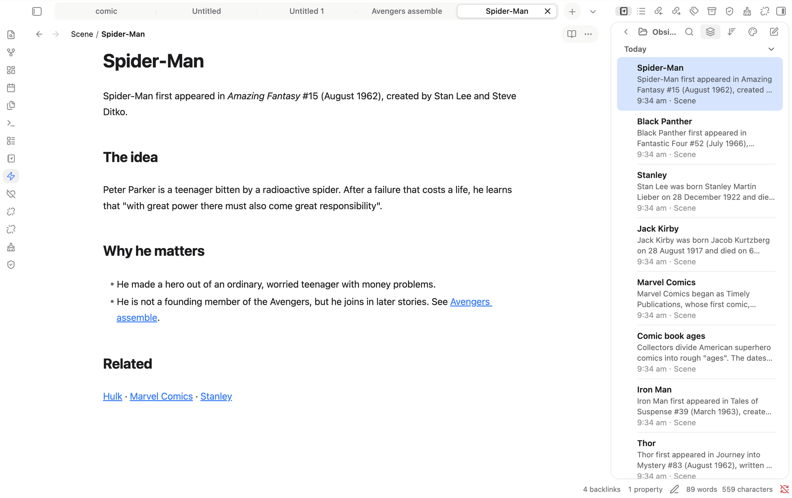
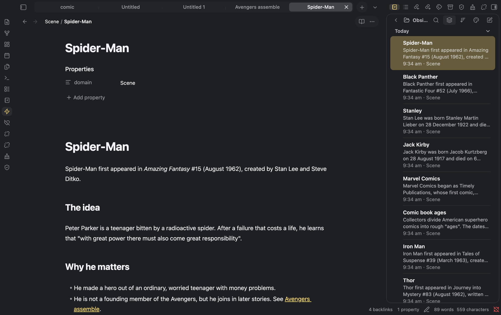

# minilite

An Apple-inspired, minimal Obsidian theme.

## Install

1. Copy this folder (`minilite`) into `<Vault>/.obsidian/themes/`.
2. In Obsidian, open Settings → Appearance → Themes and choose **minilite**.

## Light and dark mode

Settings → Appearance → Base color scheme: choose Light, Dark, or Adapt to system.

- **Light:** Finder blue (`#007aff`) accent, transparent sidebar panels, milk-white tab strip.
- **Dark:** Notes yellow (`#ffd75e`) accent, transparent sidebar panels.

## Accent colours (optional)

Install the *Style Settings* community plugin, then open Settings → Style Settings → minilite. You can choose the default, yellow in both modes, yellow with blue links, blue, green or purple. Without the plugin the default applies.

## Customising

Colours are CSS custom properties at the top of `theme.css`. The side panel (`--ans-side-*`), tabs (`--ans-tab-*`), breadcrumb path (`--ans-crumb-*`) and the reading-mode and three-dots capsule (`--ans-actions-*`) each have their own hover and selected colours.
