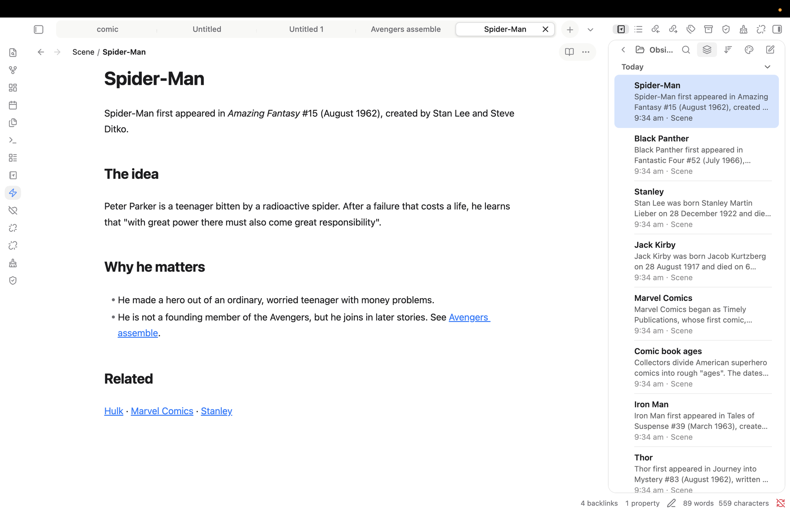
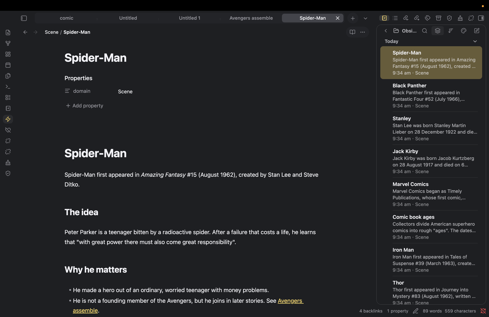

# minilite

An Apple-inspired, minimal Obsidian theme. It gives the workspace the look of macOS Notes, with a Finder and Terminal style tab strip (a solid rounded strip, thin dividers, a white rounded active tab and a circular "+" button).

## Install

1. Copy this folder (`minilite`) into `<Vault>/.obsidian/themes/`.
2. In Obsidian, open Settings → Appearance → Themes and choose **minilite**.

## Light and dark mode

Settings → Appearance → Base color scheme: choose Light, Dark, or Adapt to system.

- **Light:** Finder blue (`#007aff`) accent, transparent sidebar panels, milk-white tab strip.
- **Dark:** Notes yellow (`#ffd75e`) accent, transparent sidebar panels.

## Accent colours (optional)

Install the *Style Settings* community plugin, then open Settings → Style Settings → minilite. You can choose the default, yellow in both modes, yellow with blue links, blue, green or purple. Without the plugin the default applies.

## Customising

Colours are CSS custom properties at the top of `theme.css`. The side panel (`--ans-side-*`), tabs (`--ans-tab-*`), breadcrumb path (`--ans-crumb-*`) and the reading-mode and three-dots capsule (`--ans-actions-*`) each have their own hover and selected colours.

## Known limitations

- Obsidian has no middle note-list pane, so only the two-pane layout is styled. Notebook Navigator styling is not included.
- Selectors were written from the documented Obsidian CSS variables and the usual DOM. They have been checked only through screenshots on macOS, not in the developer tools or on Windows. If something looks off, inspect it with `Cmd+Option+I` (Mac) or `Ctrl+Shift+I` (Windows).
- Light-mode blue `#007aff` on white is about 4.0:1 contrast, just under the WCAG AA 4.5:1 for small text. Larger text and icons pass.
- The tab strip applies to normal tabs only. If your tabs show as vertical strips, **Stack tabs** is on: click the tab-list chevron at the top right of the editor and turn it off.
- Fonts are Obsidian's defaults; the theme does not set any.
- Colours from plugins and Canvas cards are not controlled by this theme.
- Not reproducible: iCloud sync, Apple Pencil, document scanning, native tab drag animations and traffic-light controls.
